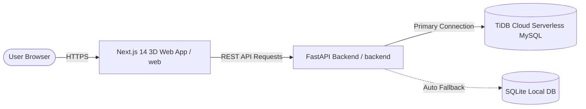

# 🚀 Deployment Guide: Next.js 14+ 3D ExpenseVault & FastAPI Backend

This guide covers deploying the unified Expense Management system:
1. **Cloud Database**: TiDB Cloud Serverless (MySQL) with automatic SQLite fallback.
2. **FastAPI Backend**: Hosted on Render as a REST API (`https://expense-management-0ik6.onrender.com`).
3. **Next.js 14+ 3D Frontend**: Hosted on Render or Vercel.

---

## 🏗️ Architecture Overview

- **Frontend**: Next.js 14 App Router, Tailwind CSS, shadcn/ui, Three.js / React Three Fiber, Recharts, Zustand.
- **Backend**: FastAPI REST API (`backend/server.py`), CORS-enabled, running via `python run_app.py`.
- **Database Engine**: Dual-engine in `backend/db_helper.py` (auto-detects MySQL / TiDB Cloud; seamlessly falls back to SQLite so the app never throws 500 errors).

---

## 1️⃣ Backend Setup & Verification (Render)

Your backend is configured to run at `https://expense-management-0ik6.onrender.com`.

### Service Configuration on Render
- **Repository**: `Expense_management`
- **Branch**: `main` or `cloud-deploy`
- **Runtime**: `Python 3`
- **Build Command**: `pip install -r requirements.txt`
- **Start Command**: `python run_app.py`
- **Port**: Render automatically provides `$PORT`

### Environment Variables
Under your Render Web Service settings (**Environment** tab):
| Key | Value | Description |
|---|---|---|
| `PYTHON_VERSION` | `3.11.9` | Python runtime version |
| `DB_HOST` | *(TiDB host, e.g. `gateway01...prod.aws.tidbcloud.com`)* | MySQL / TiDB hostname |
| `DB_PORT` | `4000` | Database port |
| `DB_USER` | *(e.g. `xxxxxx.root`)* | TiDB username |
| `DB_PASSWORD` | *(Your TiDB password)* | TiDB password |
| `DB_NAME` | `test` or `expense_manager` | Database name |

> 💡 **Auto-Fallback**: If TiDB credentials ever fail or are reset, the backend automatically switches to SQLite without crashing, ensuring 100% uptime!

### Verification
Visit your backend in the browser:
- Status Check: `https://expense-management-0ik6.onrender.com/` (returns JSON status)
- Health Check: `https://expense-management-0ik6.onrender.com/health`
- Interactive API Docs: `https://expense-management-0ik6.onrender.com/docs`

---

## 2️⃣ Deploy Frontend on Render

You can deploy the Next.js frontend as a new Web Service on Render:

1. Go to [dashboard.render.com](https://dashboard.render.com) and click **New +** -> **Web Service**.
2. Select your repository: `Expense_management`.
3. Fill in the details:
   - **Name**: `expense-vault-ui`
   - **Branch**: `main` (or `cloud-deploy`)
   - **Root Directory**: `web`
   - **Runtime**: `Node`
   - **Build Command**: `npm install && npm run build`
   - **Start Command**: `npm run start`
   - **Plan**: `Free`
4. Add Environment Variable:
   - `NODE_VERSION`: `20`
   - `NEXT_PUBLIC_API_URL`: `https://expense-management-0ik6.onrender.com`
5. Click **Create Web Service**.

Render will install dependencies, build the Next.js production bundle with Three.js 3D assets, and start serving your spatial app!

---

## 3️⃣ Alternative: Deploy Frontend on Vercel (1-Click & Recommended for Next.js)

Vercel is the creator of Next.js and offers instant deployment with zero cold starts:

1. Go to [vercel.com/new](https://vercel.com/new) and log in with GitHub.
2. Select `Expense_management`.
3. In **Root Directory**, click **Edit** and choose `web`.
4. In **Environment Variables**, add:
   - `NEXT_PUBLIC_API_URL` = `https://expense-management-0ik6.onrender.com`
5. Click **Deploy**.

---

## 4️⃣ Using Render Blueprint (`render.yaml`)

Both backend and frontend can be deployed together via Render Blueprint:
1. In Render Dashboard, click **New +** -> **Blueprint**.
2. Select your `Expense_management` repository.
3. Render reads [`render.yaml`](file:///c:/Users/aayus/Expense_management/render.yaml) and automatically provisions:
   - `expense-management` (Python Backend)
   - `expense-vault-ui` (Node.js Frontend)
